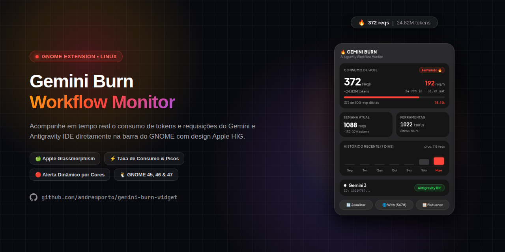

# 🔥 Gemini Burn • Monitor de Escritorio para Antigravity

<p align="center">
  
</p>

<p align="center">
  <a href="README.md">English</a> · <a href="README.pt-BR.md">Português (BR)</a> · <b>Español</b> · <a href="README.zh-CN.md">简体中文</a> · <a href="README.ru.md">Русский</a>
</p>

<p align="center">
  <b>Monitor en tiempo real de solicitudes, consumo de tokens y tasa de uso para Gemini y Antigravity en Linux.</b><br>
  Diseñado con la estética refinada de los <b>Apple Widgets</b> (macOS Sonoma / iOS), efecto glassmorphism e integración nativa con <b>GNOME Shell</b>.
</p>

<p align="center">
  
  
  
  
</p>

---

## ✨ Características y Aspectos Destacados

- 🍏 **Diseño Inspirado en los Widgets de Apple:** 
  - Contenedor base translúcido en `#2f2f2f` con efecto *glassmorphism* y desenfoque de fondo (*backdrop blur*).
  - Tarjetas internas en negro obsidiana (`#151515`) con esquinas continuas suaves (*squircles* con `border-radius: 20px`) y microbordes especulares.
  - Tipografía limpia con espaciado óptico natural.
- 🚦 **Colores Dinámicos del Sistema y Estados Inteligentes (Apple HIG):**
  - 🟢 **0% al 49% • `Activo ⚡` (Apple System Green `#30D158`):** Zona de consumo seguro, ritmo estable y acento verde.
  - 🟡 **50% al 69% • `Moderado ⚡` (Apple System Yellow `#FFD60A`):** Aviso preventivo tras superar la mitad de la cuota diaria.
  - 🔴 **70% en adelante • `Hirviendo 🔥` (Apple System Red `#FF453A`):** Ritmo intenso de uso acercándose al límite diario.
  - 🎯 **Armonía Visual Absoluta:** La etiqueta de estado, la barra de progreso, la velocidad horaria (`req/h`) y los porcentajes cambian en perfecta sincronía.
- ⚡ **Rastreo Automático Local (Cero Configuración):**
  - Analiza directamente los registros locales de sesión de Antigravity (`~/.gemini/antigravity/brain/` y `~/.gemini/antigravity-ide/brain/`).
  - No requiere claves de API para monitorizar tu flujo de trabajo en Antigravity.
  - Captura tokens reales de entrada/salida o realiza estimaciones contextuales precisas.
- 📈 **Métricas de Velocidad e Historial:**
  - **Semana Calendario:** Acumulación semanal que inicia cada lunes a las 00:00:00.
  - **Tasa de Uso por Hora (Burn Rate):** Medición continua en tiempo real de peticiones y tokens consumidos por hora.
  - **Gráfico de 7 Días:** Minigráfico de barras con picos de peticiones y resaltado inteligente en el día de hoy.
  - **Contador de Herramientas:** Registro de comandos y herramientas ejecutadas por los agentes.
- 🎛️ **Múltiples Modos de Visualización:**
  1. **Menú en la Barra Superior (Extensión GNOME Shell):** Se sitúa discretamente junto a los iconos del sistema y despliega la tarjeta completa al hacer clic.
  2. **Panel Web Local:** Accesible en cualquier navegador web moderno en `http://127.0.0.1:5678/`.
  3. **Widget de Escritorio Flotante:** Ventana independiente y arrastrable desarrollada en GTK 4 / WebKitGTK.
  4. **Panel CLI en Terminal:** Interfaz interactiva para terminal al estilo de `htop`/`btop`.

---

## 🚀 Instalación Rápida (1 Solo Comando)

Puedes instalar Gemini Burn directamente en la terminal con un solo comando (no requiere privilegios `sudo`):

```bash
curl -sSL https://raw.githubusercontent.com/andreporto/gemini-burn-widget/main/install.sh | bash
```

### Lo que hace el instalador automáticamente:
1. Instala la extensión nativa para GNOME Shell en `~/.local/share/gnome-shell/extensions/gemini-burn@andreporto/`.
2. Configura y activa el servicio en segundo plano mediante `systemd --user` (arranca solo al encender el equipo).
3. Añade el acceso directo al menú de aplicaciones de tu escritorio.

> [!IMPORTANT]
> ### ⚠️ Aviso Importante para Usuarios de Wayland (Zorin OS, Ubuntu, Fedora)
> En **Wayland** (predeterminado en distribuciones con GNOME 45+), el proceso de GNOME Shell actúa como compositor gráfico directo. Por motivos de estabilidad, GNOME **no permite reiniciar el shell en caliente** (el clásico atajo `Alt + F2` seguido de `r` de X11 no funciona en Wayland).
>
> **Qué debes tener en cuenta:**
> - Al instalar la extensión por primera vez o actualizar archivos de interfaz (`extension.js` o `stylesheet.css`), GNOME mantiene en memoria RAM el código anterior durante la sesión activa.
> - **Cómo solucionarlo:** Basta con **Cerrar Sesión (Log out)** y volver a iniciar sesión con tu usuario (o reiniciar el PC). En el nuevo inicio, GNOME Shell cargará limpiamente los archivos actualizados desde el disco.

---

## 🛠️ Instalación Manual desde Git

Si prefieres clonar e inspeccionar el código antes de ejecutarlo:

```bash
# 1. Clonar el repositorio
git clone https://github.com/andreporto/gemini-burn-widget.git
cd gemini-burn-widget

# 2. Ejecutar el instalador local
./install.sh
```

---

## 🖥️ Modos de Uso

| Modo | Comando | Descripción |
| :--- | :--- | :--- |
| **Barra Superior** | Clic en el icono `🔥` de la barra | Menú emergente nativo con estadísticas en vivo |
| **Panel Web** | `./main.py --web` | Abre el servidor web local en `http://127.0.0.1:5678/` |
| **Widget Flotante** | `./main.py --widget` | Ventana flotante de cristal arrastrable |
| **Terminal (CLI)** | `./main.py --cli` | Tablero interactivo directamente en terminal |

---

## ⚙️ Gestión del Servicio (Systemd)

El servicio recolector se ejecuta en espacio de usuario sin requerir privilegios de superusuario:

```bash
# Verificar estado del servicio
systemctl --user status gemini-burn.service

# Reiniciar el servicio
systemctl --user restart gemini-burn.service

# Detener el servicio
systemctl --user stop gemini-burn.service
```

---

## 🔒 Privacidad y Seguridad

- **100% Local y Desconectado:** Ningún contenido de tus prompts, código, tokens ni historial sale de tu ordenador.
- **Lectura Pasiva:** Solo realiza lectura pasiva de las métricas producidas localmente por tu flujo en Antigravity.
- **Almacenamiento Local:** Las preferencias y llamadas manuales se guardan localmente en `~/.gemini-burn/`.

---

## 🤝 Cómo Contribuir

¡Las contribuciones de la comunidad son muy bienvenidas! Si deseas reportar un error, proponer nuevas métricas o enviar mejoras:

1. Haz un **Fork** del repositorio.
2. Crea una rama temática (`git checkout -b feature/nueva-funcionalidad`).
3. Realiza tus commits (`git commit -m 'feat: soporte para umbrales personalizados'`).
4. Sube los cambios a tu fork (`git push origin feature/nueva-funcionalidad`).
5. Abre un **Pull Request**.

Para más detalles sobre el entorno de desarrollo y depuración de extensiones GNOME, consulta nuestra [Guía de Contribución (CONTRIBUTING.md)](CONTRIBUTING.md).

---

## ☕ Apoya el Proyecto

Si **Gemini Burn** te resulta útil en tu día a día y deseas apoyar su desarrollo continuo, ¡puedes invitarme a un café! ☕

<p align="left">
  
</p>

> **Clave PIX (Aleatoria):**  
> `883e07ea-968b-44eb-ba00-4ee5cef1221d`  
> *(Cualquier aporte es enormemente agradecido e impulsa nuevas mejoras. 🔥)*

---

## 📄 Licencia

Distribuido bajo la licencia [MIT](LICENSE). Creado para la comunidad de desarrolladores de código abierto.

