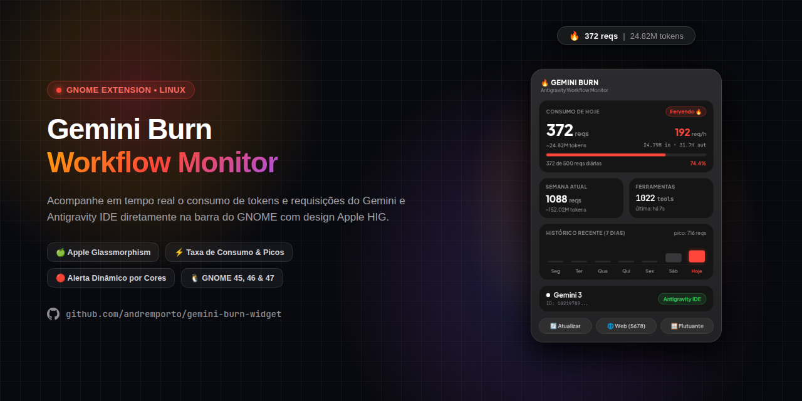

# 🔥 Gemini Burn • Antigravity Desktop Monitor

<p align="center">
  
</p>

<p align="center">
  <b>Monitor de consumo de requisições, tokens e taxa de queima do Gemini e Antigravity IDE para Linux.</b><br>
  Construído com a estética refinada dos <b>Apple Widgets</b> (macOS Sonoma / iOS), efeito glassmorphism e integração nativa com o <b>GNOME Shell</b>.
</p>

<p align="center">
  
  
  
  
</p>

---

## ✨ Destaques e Funcionalidades

- 🍏 **Design Inspirado nos Widgets da Apple:** 
  - Fundo geral translúcido em `#2f2f2f` com efeito *glassmorphism* e *backdrop blur*.
  - Cards internos em preto obsidiana `#151515` com cantos contínuos (*squircles* com `border-radius: 20px`) e micro-bordas de iluminação especular.
  - Tipografia limpa com espaçamento óptico (*optical tracking*).
- 🚦 **Cores Dinâmicas Inteligentes (Apple HIG System Colors):**
  - 🟢 **0% a 49% (Apple System Green `#30D158`):** Consumo seguro e ritmo tranquilo.
  - 🟡 **50% a 69% (Apple System Yellow `#FFD60A`):** Atenção moderada, metade da cota diária atingida.
  - 🔴 **70% em diante (Apple System Red `#FF453A`):** Ritmo intenso de queima ("Fervendo") e aproximação da meta diária.
- ⚡ **Rastreamento Automático Local (Zero Configuração):**
  - Analisa diretamente os logs locais do Antigravity IDE (`~/.gemini/antigravity-ide/brain/`).
  - Não requer chaves de API para monitorar seu fluxo do Antigravity.
  - Mapeia tokens de entrada (contexto acumulado) e saída (raciocínio/geração).
- 📈 **Métricas de Ritmo & Histórico:**
  - **Burn Rate Horário:** Medição em tempo real de requisições e tokens consumidos por hora.
  - **Histórico dos 7 Dias:** Mini gráfico de barras com pico de requisições e destaque inteligente no dia de hoje.
  - **Contador de Ferramentas:** Registro das *tools* e comandos executados pelos agentes.
- 🎛️ **Multi-Modos de Exibição:**
  1. **Menu na Barra Superior (Extensão GNOME Shell):** Fica discretamente ao lado do relógio/ícones na bandeja e desce o card completo com 1 clique.
  2. **Dashboard Web Local:** Acesse em qualquer navegador via `http://127.0.0.1:5678/`.
  3. **Widget Desktop Flutuante:** Janela independente nativa GTK 4 / WebKitGTK.
  4. **Painel CLI no Terminal:** Interface de console em tempo real estilo `htop`/`btop`.

---

## 🚀 Instalação Rápida (1 Comando)

Você pode instalar o Gemini Burn diretamente pelo terminal com um único comando (não requer `sudo`):

```bash
curl -sSL https://raw.githubusercontent.com/andreporto/gemini-burn-widget/main/install.sh | bash
```

### O que o instalador faz automaticamente:
1. Instala a extensão nativa do GNOME Shell em `~/.local/share/gnome-shell/extensions/gemini-burn@andreporto/`.
2. Cria e ativa o serviço em segundo plano no `systemd --user` (inicia sozinho ao ligar o PC).
3. Cria o atalho no menu de aplicativos do sistema.

> **Nota para o GNOME Shell:** Se for a primeira vez instalando uma extensão no GNOME sob Wayland, faça **Log out / Log in** (Encerrar Sessão) no seu usuário para o GNOME carregar a extensão na barra superior.

---

## 🛠️ Instalação Manual via Git

Caso prefira inspecionar e rodar o repositório clonado localmente:

```bash
# 1. Clonar o repositório
git clone https://github.com/andreporto/gemini-burn-widget.git
cd gemini-burn-widget

# 2. Executar o instalador local
./install.sh
```

---

## 🖥️ Modos de Uso

| Modo | Comando | Descrição |
| :--- | :--- | :--- |
| **Barra Superior** | Clique no ícone `🔥` na barra | Menu popup nativo com métricas ao vivo |
| **Painel Web** | `./main.py --web` | Abre o servidor local em `http://127.0.0.1:5678/` |
| **Widget Flutuante** | `./main.py --widget` | Janela de desktop arrastável |
| **Terminal (CLI)** | `./main.py --cli` | Dashboard interativo no terminal |

---

## ⚙️ Gerenciamento do Serviço (Systemd)

O serviço roda em segundo plano sem privilégios de root:

```bash
# Verificar status do coletor de métricas
systemctl --user status gemini-burn.service

# Reiniciar o serviço
systemctl --user restart gemini-burn.service

# Parar o serviço
systemctl --user stop gemini-burn.service
```

---

## 🔒 Privacidade e Segurança

- **100% Local e Offline:** Nenhum dado, prompt, token ou histórico sai da sua máquina.
- **Leitura Segura:** Apenas faz leitura passiva das estatísticas geradas pelo seu fluxo de trabalho no Antigravity.
- **Banco de Dados Local:** Configurações e métricas avulsas são armazenadas em `~/.gemini-burn/`.

---

## 📄 Licença

Distribuído sob a licença [MIT](LICENSE). Desenvolvido para a comunidade open source de desenvolvedores.
