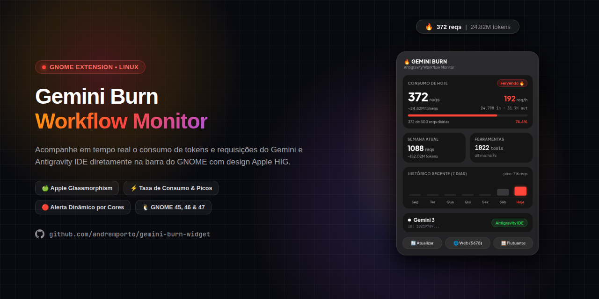

# 🔥 Gemini Burn • Монитор Antigravity для Linux

<p align="center">
  
</p>

<p align="center">
  <a href="README.md">English</a> · <a href="README.pt-BR.md">Português (BR)</a> · <a href="README.es.md">Español</a> · <a href="README.zh-CN.md">简体中文</a> · <b>Русский</b>
</p>

<p align="center">
  <b>Монитор запросов, расхода токенов и суточных лимитов для Gemini и Antigravity в реальном времени под Linux.</b><br>
  Создан в утонченной эстетике <b>Apple Widgets</b> (macOS Sonoma / iOS) с эффектом стекломорфизма и нативной интеграцией с <b>GNOME Shell</b>.
</p>

<p align="center">
  
  
  
  
</p>

---

## ✨ Особенности и возможности

- 🍏 **Дизайн в стиле Apple Widgets:**
  - Полупрозрачная подложка `#2f2f2f` с эффектом матового стекла (*glassmorphism*) и размытием фона (*backdrop blur*).
  - Внутренние карточки цвета обсидиана (`#151515`) с плавными углами суперэллипса (*squircles* с `border-radius: 20px`) и деликатной внутренней подсветкой.
  - Четкая типографика с натуральным оптическим трекингом.
- 🚦 **Динамические цвета системы и умные статусы (Apple HIG):**
  - 🟢 **От 0% до 49% • `Активно ⚡` (Apple System Green `#30D158`):** Безопасная зона, умеренный темп, зеленый акцент.
  - 🟡 **От 50% до 69% • `Умеренно ⚡` (Apple System Yellow `#FFD60A`):** Предупреждение после преодоления половины дневной квоты.
  - 🔴 **От 70% и выше • `Кипение 🔥` (Apple System Red `#FF453A`):** Высокая скорость расхода при приближении к дневному лимиту.
  - 🎯 **Полная визуальная гармония:** Статус, индикатор выполнения, часовая скорость (`req/h`) и проценты синхронизированы в реальном времени.
- ⚡ **Полностью локальный авто-трекинг (без настроек):**
  - Анализирует локальные журналы Antigravity (`~/.gemini/antigravity/brain/` и `~/.gemini/antigravity-ide/brain/`).
  - Не требует API-ключей для отслеживания рабочих процессов Antigravity.
  - Считывает точные значения входящих/исходящих токенов либо производит контекстную оценку.
- 📈 **Метрики скорости и история:**
  - **Календарная неделя:** Суммарный недельный учет, начинающийся каждый понедельник в 00:00:00.
  - **Часовой темп расхода (Burn Rate):** Непрерывное измерение запросов и токенов в час.
  - **График за 7 дней:** Мини-диаграмма с пиками активности и интеллектуальным выделением текущего дня.
  - **Счетчик инструментов:** Подсчет команд и инструментов, выполненных агентами.
- 🎛️ **Несколько режимов отображения:**
  1. **Панель в верхней строке (расширение GNOME Shell):** Находится рядом с системным треем и раскрывает карточку в один клик.
  2. **Локальный веб-дашборд:** Доступен в любом браузере по адресу `http://127.0.0.1:5678/`.
  3. **Плавающий виджет на рабочем столе:** Отдельное окно на GTK 4 / WebKitGTK с возможностью перемещения.
  4. **Интерфейс в терминале (CLI):** Интерактивная консоль в стиле `htop`/`btop`.

---

## 🚀 Быстрая установка (одной командой)

Установите Gemini Burn напрямую через терминал без прав `sudo`:

```bash
curl -sSL https://raw.githubusercontent.com/andreporto/gemini-burn-widget/main/install.sh | bash
```

### Что делает скрипт автоматически:
1. Устанавливает расширение GNOME Shell в `~/.local/share/gnome-shell/extensions/gemini-burn@andreporto/`.
2. Настраивает и включает фоновую службу `systemd --user` (запускается при старте системы).
3. Создает ярлык в меню приложений вашей системы.

> [!IMPORTANT]
> ### ⚠️ Важно для пользователей Wayland (Zorin OS, Ubuntu, Fedora)
> В сессиях **Wayland** (стандарт в GNOME 45+) процесс GNOME Shell выступает прямым графическим композитором. В целях стабильности системы GNOME **блокирует перезапуск оболочки на лету** (комбинация `Alt + F2` и `r` из X11 не работает в Wayland).
>
> **Что нужно знать:**
> - После первой установки расширения или изменения файлов интерфейса (`extension.js` или `stylesheet.css`) GNOME сохраняет старый код в оперативной памяти до завершения сеанса.
> - **Как применить изменения:** Просто **Завершите сеанс (Log out)** и войдите снова в систему (или перезагрузите ПК). При новом входе GNOME Shell загрузит свежие файлы с диска.

---

## 🛠️ Установка вручную из Git

Если вы хотите склонировать и изучить репозиторий локально:

```bash
# 1. Клонировать репозиторий
git clone https://github.com/andreporto/gemini-burn-widget.git
cd gemini-burn-widget

# 2. Запустить локальный установщик
./install.sh
```

---

## 🖥️ Режимы запуска

| Режим | Команда | Описание |
| :--- | :--- | :--- |
| **Верхняя панель** | Клик по иконке `🔥` | Всплывающее меню с метриками в реальном времени |
| **Веб-панель** | `./main.py --web` | Запуск локального сервера по адресу `http://127.0.0.1:5678/` |
| **Плавающий виджет** | `./main.py --widget` | Перемещаемое стеклянное окно на рабочем столе |
| **Терминал (CLI)** | `./main.py --cli` | Интерактивная сводка прямо в терминале |

---

## ⚙️ Управление службой (Systemd)

Фоновый сборщик работает исключительно в пространстве пользователя без root-прав:

```bash
# Проверить статус службы
systemctl --user status gemini-burn.service

# Перезапустить службу
systemctl --user restart gemini-burn.service

# Остановить службу
systemctl --user stop gemini-burn.service
```

---

## 🔒 Конфиденциальность и безопасность

- **100% локально и оффлайн:** Никакой код, промпты, токены или история никогда не покидают ваш компьютер.
- **Пассивный сбор:** Только локальный анализ логов, созданных рабочим процессом Antigravity.
- **Локальное хранение:** Настройки и вызовы сохраняются исключительно в `~/.gemini-burn/`.

---

## 🤝 Участие в разработке

Мы рады любому вкладу сообщества! Если вы нашли ошибку или хотите предложить улучшение:

1. Сделайте **Fork** репозитория.
2. Создайте тематическую ветку (`git checkout -b feature/new-cool-feature`).
3. Зафиксируйте изменения (`git commit -m 'feat: добавление нового лимита'`).
4. Отправьте ветку в свой форк (`git push origin feature/new-cool-feature`).
5. Откройте **Pull Request**.

Подробности о локальной разработке расширений GNOME читайте в [Руководстве по участию (CONTRIBUTING.md)](CONTRIBUTING.md).

---

## ☕ Поддержка проекта

Если **Gemini Burn** помогает вам в повседневной разработке и вы хотите поддержать проект, вы можете угостить меня чашкой кофе! ☕

<p align="left">
  
</p>

> **Ключ PIX (Случайный):**  
> `883e07ea-968b-44eb-ba00-4ee5cef1221d`  
> *(Любая поддержка мотивирует на создание новых функций! 🔥)*

---

## 📄 Лицензия

Распространяется под лицензией [MIT](LICENSE). Создано для сообщества разработчиков открытого исходного кода.

