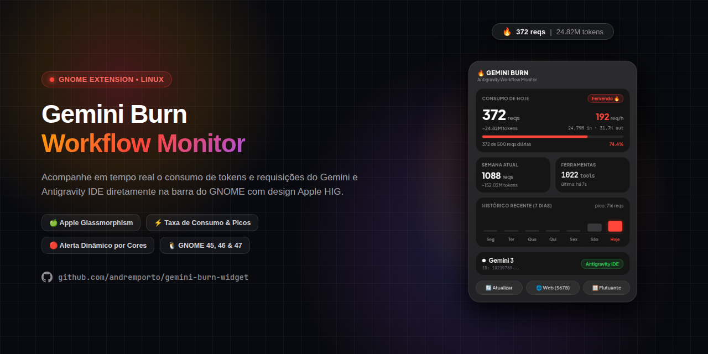

# 🔥 Gemini Burn • Antigravity 桌面监控组件

<p align="center">
  
</p>

<p align="center">
  <a href="README.md">English</a> · <a href="README.pt-BR.md">Português (BR)</a> · <a href="README.es.md">Español</a> · <b>简体中文</b> · <a href="README.ru.md">Русский</a>
</p>

<p align="center">
  <b>面向 Linux 的 Gemini 与 Antigravity 请求频率、Token 消耗率与配额实时桌面监控工具。</b><br>
  采用精致的 <b>Apple 小组件</b> (macOS Sonoma / iOS) 磨砂毛玻璃风格设计，并与 <b>GNOME Shell</b> 深度原生集成。
</p>

<p align="center">
  
  
  
  
</p>

---

## ✨ 功能亮点

- 🍏 **灵感源自 Apple 小组件的设计：**
  - `#2f2f2f` 半透明磨砂玻璃质感与背景模糊 (*Backdrop Blur*)。
  - 曜石黑内部卡片 (`#151515`)，搭配优雅的连续平滑圆角 (*Squircle*，`border-radius: 20px`) 与高光内边缘。
  - 清晰优雅的字体与舒适的光学字间距。
- 🚦 **动态系统配色与智能状态指示 (遵循 Apple HIG)：**
  - 🟢 **0% 至 49% • `活跃 ⚡` (Apple 系统绿 `#30D158`)：** 处于安全消耗区间，节奏平稳，绿色主题。
  - 🟡 **50% 至 69% • `温和 ⚡` (Apple 系统黄 `#FFD60A`)：** 消耗超过每日额度一半时的预防性提示。
  - 🔴 **70% 及以上 • `炽热 🔥` (Apple 系统红 `#FF453A`)：** 处于高频消耗节奏，接近每日限额。
  - 🎯 **完美视觉协调：** 状态标签、进度条、每小时速率 (`req/h`) 及百分比保持完全同步变化。
- ⚡ **本地全自动追踪 (零配置)：**
  - 直接分析 Antigravity 本地日志文件 (`~/.gemini/antigravity/brain/` 与 `~/.gemini/antigravity-ide/brain/`)。
  - 无需配置任何 API Key 即可监控 Antigravity 工作流。
  - 自动捕获真实的输入/输出 Token，或进行精确的上下文估算。
- 📈 **速率指标与历史记录：**
  - **日历周统计：** 每周一 00:00:00 重新累加的完整周度数据。
  - **每小时消耗率 (Burn Rate)：** 实时统计每小时产生的请求次数与 Token 消耗。
  - **7 天历史图表：** 迷你柱状图直观展示历史请求峰值，并智能突出显示今日用量。
  - **工具调用统计：** 统计 Agent 执行的所有工具及后台指令调用次数。
- 🎛️ **多模态展示方式：**
  1. **顶栏面板组件 (GNOME Shell 扩展)：** 驻留在托盘图标旁，点击即可展开完整的卡片面板。
  2. **本地 Web 仪表盘：** 通过任意现代浏览器访问 `http://127.0.0.1:5678/`。
  3. **独立悬浮小组件：** 基于 GTK 4 / WebKitGTK 的独立毛玻璃可拖拽桌面窗口。
  4. **终端 CLI 面板：** 类似 `htop`/`btop` 的实时交互式控制台界面。

---

## 🚀 一键快速安装 (无需 root 权限)

直接在终端运行以下一行命令即可完成安装：

```bash
curl -sSL https://raw.githubusercontent.com/andreporto/gemini-burn-widget/main/install.sh | bash
```

### 安装脚本自动完成的内容：
1. 将 GNOME Shell 原生扩展安装至 `~/.local/share/gnome-shell/extensions/gemini-burn@andreporto/`。
2. 创建并启用 `systemd --user` 后台服务 (开机自动启动)。
3. 在应用程序菜单中生成桌面快捷方式。

> [!IMPORTANT]
> ### ⚠️ Wayland 用户注意事项 (Zorin OS, Ubuntu, Fedora 等)
> 在 **Wayland** 显示协议下 (现代 GNOME 45+ 系统的默认模式)，GNOME Shell 进程直接充当显示混成器。出于系统安全稳定性考虑，GNOME **禁止在运行期热重启 Shell** (传统的 X11 快捷键 `Alt + F2` 然后输入 `r` 在 Wayland 下无法生效)。
>
> **注意事项：**
> - 初次安装扩展或更新界面文件 (`extension.js` 或 `stylesheet.css`) 后，GNOME 会在当前会话的内存中保留旧模块代码。
> - **解决方法：** 只需 **注销当前用户 (Log out)** 并重新登录 (或重启计算机)。重新登入后，GNOME Shell 将重新从硬盘加载全新文件。

---

## 🛠️ 从 Git 源码手动安装

如果你想克隆并在本地审查代码：

```bash
# 1. 克隆代码仓库
git clone https://github.com/andreporto/gemini-burn-widget.git
cd gemini-burn-widget

# 2. 执行本地安装脚本
./install.sh
```

---

## 🖥️ 运行模式

| 模式 | 启动命令 | 简介 |
| :--- | :--- | :--- |
| **顶部面板** | 点击顶栏上的 `🔥` 图标 | 原生弹出式卡片，实时数据更新 |
| **Web 仪表盘** | `./main.py --web` | 在 `http://127.0.0.1:5678/` 启动本地网页 |
| **悬浮小组件** | `./main.py --widget` | 桌面毛玻璃半透明浮动窗口 |
| **终端 (CLI)** | `./main.py --cli` | 终端交互式动态控制面板 |

---

## ⚙️ 后台服务管理 (Systemd)

监控采集服务在纯用户空间运行，无需 root 特权：

```bash
# 查看指标采集器运行状态
systemctl --user status gemini-burn.service

# 重启采集服务
systemctl --user restart gemini-burn.service

# 停止采集服务
systemctl --user stop gemini-burn.service
```

---

## 🔒 隐私与安全性

- **100% 本地离线：** 绝不会将您的提示词、代码、Token 或历史记录上传至外网。
- **被动本地解析：** 仅对 Antigravity 本地生成的运行时指标进行被动读取。
- **本地存储：** 配置项与手动 API 记录仅保存在 `~/.gemini-burn/` 目录下。

---

## 🤝 参与贡献

非常欢迎来自开源社区的贡献与反馈！如果您发现了 Bug、有新指标建议或想提交 PR：

1. **Fork** 本代码仓库。
2. 创建您的功能特性分支 (`git checkout -b feature/my-cool-feature`)。
3. 提交代码变更 (`git commit -m 'feat: 增加自定义每日Token阈值'`)。
4. 推送分支至您的仓库 (`git push origin feature/my-cool-feature`)。
5. 提交一个 **Pull Request**。

详细的本地开发调试指南请参考 [贡献指南 (CONTRIBUTING.md)](CONTRIBUTING.md)。

---

## ☕ 赞助与支持

如果 **Gemini Burn** 提升了您的日常开发效率，欢迎考虑给我买杯咖啡！☕

<p align="left">
  
</p>

> **PIX 密钥 (随机)：**  
> `883e07ea-968b-44eb-ba00-4ee5cef1221d`  
> *(任何心意都将极大鼓舞本项目的持续更新！🔥)*

---

## 📄 开源许可证

本项目基于 [MIT](LICENSE) 许可证开源。为开源开发者社区倾心打造。

